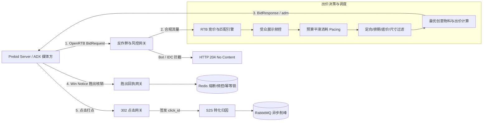

# DSP 程序化广告投放与实时竞价系统

[](https://www.oracle.com/java/)
[](https://spring.io/)
[](https://www.iab.com/guidelines/openrtb/)
[](https://swagger.io/)
[](docs/testing-guide.md)

企业级程序化广告需求方平台（Demand-Side Platform, DSP），提供全链路广告主自主投放、多维定向广告活动管理、创意物料审核，以及原生支持 **OpenRTB 2.5** 协议和 **Prebid Server**（Header Bidding）毫秒级实时竞价与结算。

---

## 核心架构与业务全景



---

## 核心系统特性

* **实时竞价引擎 (OpenRTB 2.5 / Prebid Server)**：毫秒级多维度条件过滤（排期、定向、尺寸、底价），支持 `${AUCTION_PRICE}` 第二价格动态宏替换与 HTTP 204 快速放弃出价机制。
* **预竞价反作弊风控 (Pre-bid Anti-Fraud)**：内置云厂商 IDC 网段（AWS, GCP, 阿里云, 腾讯云等 29 个 CIDR）纳秒级位运算拦截、爬虫 Bot UA 正则过滤及 Redis 动态 IP 黑名单。
* **受众精细化展示频控 (Frequency Capping)**：基于硬件 IFA、用户标识或网络指纹构建唯一受众标识，支持活动天/小时双时间窗口原子频控与胜出延迟确认。
* **平滑预算消耗调度 (Budget Pacing)**：支持 `ASAP` 冲刺跑量与 `EVEN` 均摊平滑消耗模式，依托动态概率节流算法（Probabilistic Throttling）杜绝开盘瞬间预算超支。
* **多媒体创意多格式支持 (Video / Native)**：原生支持标准 Banner HTML、IAB VAST 3.0 视频广告 XML 组装与 IAB OpenRTB Native 1.2 原生信息流 JSON 资产生成。
* **点击追踪与 S2S 效果转化归因 (Attribution)**：提供 `/v2/openrtb/click` 302 重定向落地页跳转与 `/v2/openrtb/conversion` 服务端回传，结合 Redis 防重排重与 RabbitMQ 异步削峰事件投递。
* **高并发预算熔断与防重核销**：基于 Redis 原子操作实现实时日预算熔断（防止并发超卖），结合分布式排他锁实现胜出通知幂等防重计费。
* **多层级权限与安全隔离**：全系统严格防垂直/水平越权控制，强制执行广告主资质认证拦截（未过审禁止投放），敏感数据脱敏展示。
* **标准 API 文档化 (Swagger / OpenAPI)**：集成 Springfox Swagger 2.9.2，全量核心控制器添加规范化注解与在线交互调试。

---

## 快速上手

### 1. 环境准备
* **JDK**: 1.8.0_202+
* **Maven**: 3.6.0+
* **中间件**: MySQL 5.7+ / 8.0+、Redis 3.2+、RabbitMQ 3.6+

### 2. 编译与执行端到端测试
```bash
# 执行全部 21 项端到端测试套件（含业务全链路、OpenRTB 基础竞价与 Phase 1 & 2 进阶特性）
mvn test "-Dtest=DspComprehensiveE2ETest,OpenRtbBiddingE2ETest,OpenRtbAdvancedFeaturesE2ETest"

# 快速编译打包 WAR
mvn clean package -DskipTests
```
> 若本地无 Maven 或 JDK 8 环境，亦可通过 Docker 一键执行：
> ```bash
> docker run --rm -v "$(pwd)":/app -v ~/.m2:/root/.m2 -w /app maven:3.8.8-eclipse-temurin-8 mvn test "-Dtest=DspComprehensiveE2ETest,OpenRtbBiddingE2ETest,OpenRtbAdvancedFeaturesE2ETest"
> ```

### 3. 在线 API 调试
启动服务后访问：
* **Swagger UI 交互控制台**: `http://localhost:8080/swagger-ui.html`
* **OpenAPI 规范源端点**: `http://localhost:8080/v2/api-docs`

---

## 二级技术文档导航

为了保持首页简明扼要，系统各项深度设计、协议标准与排障说明已细化至二级专属文档，欢迎查阅：

| 章节名称 | 核心内容说明 | 文档跳转 |
| :--- | :--- | :---: |
| **系统架构与模块设计** | 整体微服务架构、Prebid Server 对接流、模块拓扑、高并发安全策略 | [查看架构设计](docs/architecture.md) |
| **OpenRTB 2.5 接入规范** | BidRequest / BidResponse 协议标准、`${AUCTION_PRICE}` 宏替换、胜出计费 | [查看协议规范](docs/openrtb-spec.md) |
| **高级特性与风控归因** | 预竞价反作弊、展示频控、Pacing 算法、VAST 3.0 / Native、转化归因 | [查看高级特性](docs/advanced-features.md) |
| **端到端测试与质量保障** | 21 项端到端测试套件详解、测试矩阵、隔离策略与持续集成门禁 | [查看测试指南](docs/testing-guide.md) |
| **部署与容器化运维指南** | 中间件配置、Profile 环境切换、Docker 容器化部署与故障排查 | [查看部署指南](docs/deployment.md) |
| **核心缺陷修复与安全加固** | 梳理 18 项核心缺陷修复（含防超卖、防重核销、越权加固与兼容性） | [查看修复清单](docs/bugfixes.md) |
| **OpenAPI / Swagger 规范定义** | 标准 OpenAPI 3.0 YAML 格式接口定义文件，支持导入 Apifox / Postman | [查看 API 规范](docs/api/swagger-openrtb-api.yaml) |

---

## 许可说明
本项目遵循企业内部授权许可协议。