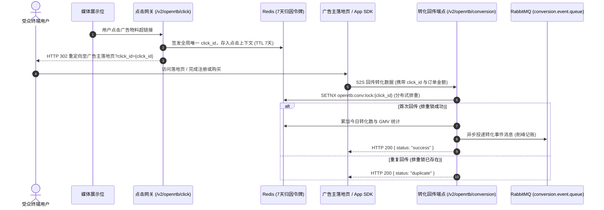

# DSP 高级特性实现指南 (Phase 1 & Phase 2)

本文档详细阐述 DSP 系统在 **Phase 1（投放精准度与成本风控）** 与 **Phase 2（多媒体格式与效果归因）** 阶段实现的高阶特性架构、算法原理、数据结构与交互协议。

---

## 1. 预竞价反作弊过滤体系 (Pre-bid Anti-Fraud IVT Engine)

在流量接入与出价决策的最前置阶段，系统通过 [`AntiFraudFilter`](file:///C:/Users/Benjamin/orca/workspaces/dsp/DSP/src/main/java/org/codeworks/dsp/openrtb/filter/AntiFraudFilter.java) 对无效流量（Invalid Traffic, IVT）进行纳秒级阻断，避免下游数据库与匹配算力浪费。

### 1.1 机房 / IDC IP 网段位运算拦截
* **业务背景**：广告点击与展现主要来自真人移动终端或家庭宽带，云厂商/机房 IP 大多为自动化爬虫、云端代理或作弊农场。
* **实现原理**：
  - 将点分十进制 IPv4 地址通过位移转换为 32 位无符号整数；
  - 内存预加载 AWS、Google Cloud (GCP)、阿里云、腾讯云、DigitalOcean、Hetzner 等主流云厂商的核心 CIDR 子网网段；
  - 使用子网掩码进行按位与运算：`(ipLong & mask) == network`，判定耗时控制在微秒级；
  - 自动解析 `X-Forwarded-For` 代理链，提取首个真实公网客户端 IP。

### 1.2 爬虫与自动化工具 User-Agent 过滤
* 内置高性能预编译正则表达式：
  ```regex
  (?i)(curl|python-requests|httpclient|headlesschrome|phantomjs|scrapy|spider|bot|crawler|wget|postman|apachebench|feedly)
  ```
* 凡命中上述特征的询价请求直接在网关层丢弃。

### 1.3 动态 IP 黑名单机制
* 支持运营人员或外部风控系统通过 Redis 动态注入惩罚名单：
  - 键前缀：`openrtb:blacklist:ip:<ip>` 或 `antifraud:blacklist:ip:<ip>`；
  - 查询到键存在即阻断。

### 1.4 快速阻断响应
* 命中任何一项反作弊规则，引擎立即返回 **HTTP 204 No Content**（符合 IAB OpenRTB 规范的 NO_BID 响应），迅速释放 HTTP 连接。

---

## 2. 受众精细化展示频次控制 (Frequency Capping)

为防止同一用户被高频重复广告骚扰，并提升广告主的曝光广度与 ROI，系统提供用户维度的天级与小时级频次限制。

### 2.1 唯一受众标识提炼算法
提取唯一标识遵循如下优先级策略：
1. **优先**：硬件设备唯一广告标识符 `device.ifa`（如 iOS IDFA / Android GAID）；
2. **次选**：媒体方用户标识符 `user.id`；
3. **兜底**：基于客户端网络指纹 `MD5(device.ip + ":" + device.ua)` 构造伪设备标识。

### 2.2 Redis 原子计数与窗口对齐
* **天级频控键**：`openrtb:fc:daily:<campaignId>:<YYYY-MM-DD>:<userId>`（TTL 自动对齐至当天 23:59:59，多保留 1 天缓冲）；
* **小时级频控键**：`openrtb:fc:hour:<HH>:<campaignId>:<YYYY-MM-DD>:<userId>`（TTL 3 小时）。
* **核验与累加闭环**：
  - **竞价前置核验**：`OpenRtbBiddingServiceImpl.processBid` 读取对应 Key，当 `count >= freqCapDaily` 或 `count >= freqCapHourly` 时直接跳过该候选活动；
  - **胜出原子累加**：收到媒体胜出通知（`/v2/openrtb/win`）并确认展示后，调用 Redis `INCR` 原子累加，防止未实际展示却误扣频次。

---

## 3. 预算平滑消耗调度算法 (Budget Pacing)

在活动实体 [`Campaign`](file:///C:/Users/Benjamin/orca/workspaces/dsp/DSP/src/main/java/org/codeworks/dsp/model/entities/Campaign.java) 中提供 `pacingMode` 配置：

### 3.1 ASAP 模式 (冲刺跑量)
* 只要活动未耗尽全天总预算且在有效排期内，100% 积极出价，适用于大促节点或新物料冷启动测试。

### 3.2 EVEN 模式 (匀速平滑消耗 / Pacing)
* **小时预算基准**：$Budget_{hour} = \frac{Budget_{daily}}{24.0}$
* **分钟进度预期**：当前分钟进度 $Prog = \frac{minute + 1}{60.0}$，计算预期消耗 $Spend_{target} = Budget_{hour} \times Prog$；
* **动态概率节流 (Probabilistic Throttling)**：
  - 若当前小时已消耗 $Spend_{hour} > Spend_{target}$，按比例计算动态放行概率：
    $$PassRatio = \max\left(0.05, \frac{Spend_{target}}{Spend_{hour} + 0.01}\right)$$
  - 产生随机数 $R \in [0, 1)$，仅当 $R \le PassRatio$ 时放行出价，否则主动返回 204；
  - 若当前小时消耗已达到或超过该小时总额度 $Budget_{hour}$，直接拦截；
  - 有效防止早高峰瞬间烧光全天预算，拉长曝光生命周期。

---

## 4. 多媒体广告物料支持 (Video VAST 3.0 & Native 1.2)

### 4.1 视频广告 (IAB VAST 3.0)
* 出价引擎识别 `BidRequest.imp[].video` 广告位，匹配视频尺寸（`w`/`h`）与播放时长区间（`minduration` / `maxduration`）；
* 胜出响应中，[`Material.renderAdm(...)`](file:///C:/Users/Benjamin/orca/workspaces/dsp/DSP/src/main/java/org/codeworks/dsp/model/entities/Material.java) 自动组装标准 VAST 3.0 XML 结构：
  - `<InLine>`：内联广告声明；
  - `<Duration>`：标准格式时长（如 `00:00:15`）；
  - `<Impression>`：曝光监测打点；
  - `<TrackingEvents>`：视频播放进度监测点（start, midpoint, complete）；
  - `<VideoClicks><ClickThrough>`：点击跳转落地页（内嵌 DSP 点击追踪网关）；
  - `<MediaFiles><MediaFile>`：支持 Progressive MP4 视频流分发。

### 4.2 原生广告 (IAB OpenRTB Native 1.2)
* 出价引擎识别 `imp[].native` 原生广告位；
* 胜出响应组装符合 Native 1.2 标准的结构化资产 JSON：
  - `title`：主标题文案；
  - `img`：包含主图（Type 3）与应用图标（Type 1）；
  - `data`：包含副标题描述（Type 2）与行动号召 CTA 文案（Type 12，如“立即购买”）；
  - `link`：点击落地页与跳转链路；
  - `imptrackers`：展示曝光探针数组。

---

## 5. 点击追踪与 S2S 效果转化归因 (Attribution)

系统打通从广告物料曝光到点击跳转、再到广告主后端 S2S 效果转化回传的完整闭环：



### 5.1 点击网关接口
* **URL**: `GET /v2/openrtb/click`（别名：`/openrtb2/click`, `/v2/rtb/click`）
* **参数**: `bidId`, `campaignId`, `advId`, `materialId`, `redirect`
* **动作**:
  1. 生成全局高熵令牌：`click_id = clk-<UUID>`；
  2. Redis 记录上下文 `openrtb:click:<click_id>`，保留 7 天；
  3. 执行落地页安全 URI 编码与拼接，返回 **HTTP 302 Found** 跳转。

### 5.2 S2S 转化回传接口
* **URL**: `GET|POST /v2/openrtb/conversion`（支持 Query 参数、Form 表单与 `application/json` 请求体）
* **参数**:
  - `click_id`: 点击唯一令牌（必需）；
  - `conv_type`: 转化类型（如 `install`, `register`, `purchase`）；
  - `order_amount`: 交易金额（GMV，用于计算 ROAS / CPA）；
* **处理保障**:
  - **分布式防刷排重**：基于 Redis `SETNX openrtb:conv:lock:<click_id>` 锁定 7 天；
  - **异步解耦**：转化事件投递至 RabbitMQ 队列 `campaign.log`，彻底保障 API 在大促高并发下的毫秒级响应。
