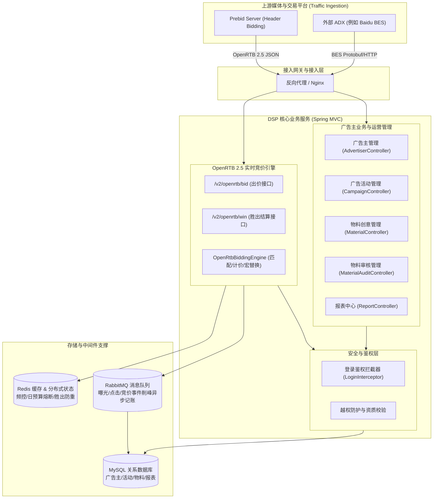

# DSP 广告投放与实时竞价系统架构设计

## 1. 系统全景架构图

系统采用经典的分布式广告投放与实时竞价架构，上游对接 Prebid Server 与主流 ADX（如百度 BES），下游依托 MySQL、Redis 与 RabbitMQ 提供高可用、低延迟的竞价结算服务。



---

## 2. 模块分层与代码结构

```
org.codeworks.dsp
├── adx                     # 外部 ADX 适配包（百度 BES 协议封装、报表拉取与物料同步）
│   └── bes
├── config                  # Spring 配置类（SwaggerConfig 等）
├── controller              # 业务控制器
│   ├── interceptor         # 拦截器（登录拦截、Session 上下文管理）
│   └── site                # 广告主与管理端 API（活动、物料、分类、报表、工作台）
│       ├── admin
│       ├── campaign
│       ├── category
│       └── creatives
├── dao                     # 数据访问层（Spring Data JPA Repository）
├── handler                 # 文件与批量处理（Excel 字典解析导入）
├── interceptor             # 数据同步拦截器（活动、物料状态联动）
├── model                   # 领域模型
│   ├── dto                 # 请求响应传输对象
│   ├── entities            # JPA 持久化实体
│   ├── groups              # Hibernate Validator 分组校验
│   └── views               # Jackson JsonView 序列化视图
├── openrtb                 # OpenRTB 2.5 协议与引擎扩展
│   ├── controller          # 竞价与胜出回执 Web 控制器
│   ├── dto                 # 标准 OpenRTB 2.5 Request/Response DTO
│   └── service             # 出价决策、多层过滤、频控与预算熔断
├── scheduler               # 定时调度任务（JobManager 定时对账与清理）
├── service                 # 核心业务服务接口与实现
└── utils                   # 常用工具类（加密、日期、缓存、网络）
```

---

## 3. Prebid Server / OpenRTB 核心流转机制

### 3.1 实时竞价链路 (Bid Pipeline)
1. **请求接入**：Prebid Server 发起 `POST /v2/openrtb/bid` 请求。
2. **合法性初筛**：校验请求体合法性，提取所有展示位（Impression）。
3. **活动检索与资格过滤**：
   - 广告活动处于有效日期区间内；
   - 广告活动状态为有效投放（Status = eligible）；
   - 广告主通过资质审查；
   - 满足尺寸（Width x Height）匹配；
   - 满足底价约束（`BidPrice >= imp.bidfloor`）；
   - 日预算熔断检查（检查 Redis 中今日累计扣减金额是否超限）。
4. **决策与响应构造**：
   - 从候选物料中选择最优创意；
   - 构造 OpenRTB 2.5 `BidResponse`，注入包含 `${AUCTION_PRICE}` 宏的 `nurl`（胜出通知）与 `adm`（广告代码片段）。
   - 若无任何候选命中，返回 HTTP 204 No Content 快速释放连接，降低下游网络开销。

### 3.2 胜出回执与计费核销链路 (Win Notice Pipeline)
1. **客户端/服务器回执触发**：媒体端赢得展示后，浏览器或 Prebid Server 回调 `GET/POST /v2/openrtb/win`。
2. **动态宏替换**：ADX / Prebid Server 将 `${AUCTION_PRICE}` 替换为真实结算第二价格（如 `1.85`）。
3. **幂等防重保障**：
   - 使用 Redis 记录 `openrtb:win:{bidId}` 键，设置分布式互斥；
   - 保证毫秒级并发重复通知仅首次计入消耗，杜绝重复扣款。
4. **预算累加与日预算熔断触发**：
   - 将胜出金额累加至 Redis 缓存；
   - 若累计金额超过活动日限额，置位熔断标记，后续出价直接跳过该活动。
5. **异步记账持久化**：
   - 写入本地 MySQL 数据库更新实际账单或投递 RabbitMQ 削峰异步落库。

---

## 4. 关键安全与高可用保障

1. **防垂直越权 (Horizontal & Vertical Authorization)**：
   - 严格在 Controller 层校验 Session 中登录账号与传入的 `advId`。
   - 非管理员访问非自身名下数据一律拦截并返回 HTTP 403 Forbidden。
2. **资质前置硬拦截 (Account Verification Guard)**：
   - 广告活动创建、更新与投放前，校验广告主资质审核状态 `Review.eligible`，未过审一律拒绝操作。
3. **高并发缓存与降级双轨制 (Redis / In-Memory Fallback)**：
   - Redis 连接可用时，出价与核销全走 Redis 毫秒级计数与分布式锁；
   - 若 Redis 发生瞬时故障，内存并发字典（`ConcurrentHashMap`）平滑兜底，保障服务永不崩溃。
