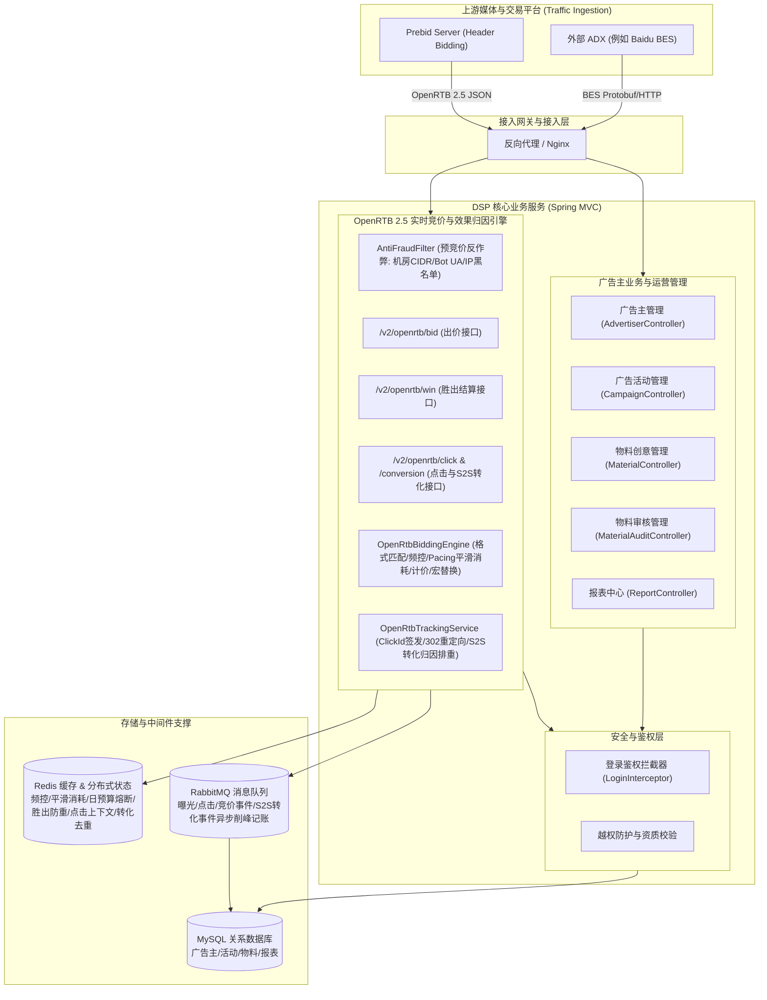

# DSP 广告投放与实时竞价系统架构设计

## 1. 系统全景架构图

系统采用经典的分布式广告投放与实时竞价架构，上游对接 Prebid Server 与主流 ADX（如百度 BES），下游依托 MySQL、Redis 与 RabbitMQ 提供高可用、低延迟的竞价结算服务。



---

## 2. 模块分层与代码结构

```
org.codeworks.dsp
├── adx                     # 外部 ADX 适配包（百度 BES 协议封装、报表拉取与物料同步）
│   └── bes
├── config                  # Spring 配置类（SwaggerConfig 等）
├── controller              # 业务控制器
│   ├── interceptor         # 拦截器（登录拦截、Session 上下文管理）
│   └── site                # 广告主与管理端 API（活动、物料、分类、报表、工作台）
│       ├── admin
│       ├── campaign
│       ├── category
│       └── creatives
├── dao                     # 数据访问层（Spring Data JPA Repository）
├── handler                 # 文件与批量处理（Excel 字典解析导入）
├── interceptor             # 数据同步拦截器（活动、物料状态联动）
├── model                   # 领域模型
│   ├── dto                 # 请求响应传输对象
│   ├── entities            # JPA 持久化实体
│   ├── groups              # Hibernate Validator 分组校验
│   └── views               # Jackson JsonView 序列化视图
├── openrtb                 # OpenRTB 2.5 协议与实时竞价/归因扩展
│   ├── controller          # 竞价、胜出回执、点击追踪与转化归因 Web 控制器
│   ├── dto                 # 标准 OpenRTB 2.5 Request/Response DTO
│   ├── filter              # 预竞价反作弊过滤层 (AntiFraudFilter)
│   └── service             # 出价决策、多层过滤、频控、Pacing与转化归因服务
├── scheduler               # 定时调度任务（JobManager 定时对账与清理）
├── service                 # 核心业务服务接口与实现
└── utils                   # 常用工具类（加密、日期、缓存、网络）
```

---

## 3. Prebid Server / OpenRTB 核心流转机制

### 3.1 实时竞价链路 (Bid Pipeline)
1. **请求接入**：Prebid Server 发起 `POST /v2/openrtb/bid` 请求。
2. **合法性初筛**：校验请求体合法性，提取所有展示位（Impression）。
3. **活动检索与资格过滤**：
   - 广告活动处于有效日期区间内；
   - 广告活动状态为有效投放（Status = eligible）；
   - 广告主通过资质审查；
   - 满足尺寸（Width x Height）匹配；
   - 满足底价约束（`BidPrice >= imp.bidfloor`）；
   - 日预算熔断检查（检查 Redis 中今日累计扣减金额是否超限）。
4. **决策与响应构造**：
   - 从候选物料中选择最优创意；
   - 构造 OpenRTB 2.5 `BidResponse`，注入包含 `${AUCTION_PRICE}` 宏的 `nurl`（胜出通知）与 `adm`（广告代码片段）。
   - 若无任何候选命中，返回 HTTP 204 No Content 快速释放连接，降低下游网络开销。

### 3.2 胜出回执与计费核销链路 (Win Notice Pipeline)
1. **客户端/服务器回执触发**：媒体端赢得展示后，浏览器或 Prebid Server 回调 `GET/POST /v2/openrtb/win`。
2. **动态宏替换**：ADX / Prebid Server 将 `${AUCTION_PRICE}` 替换为真实结算第二价格（如 `1.85`）。
3. **幂等防重保障**：
   - 使用 Redis 记录 `openrtb:win:{bidId}` 键，设置分布式互斥；
   - 保证毫秒级并发重复通知仅首次计入消耗，杜绝重复扣款。
4. **预算累加与日预算熔断触发**：
   - 将胜出金额累加至 Redis 缓存；
   - 若累计金额超过活动日限额，置位熔断标记，后续出价直接跳过该活动。
5. **异步记账持久化**：
   - 写入本地 MySQL 数据库更新实际账单或投递 RabbitMQ 削峰异步落库。

---

## 4. 关键安全与高可用保障

1. **防垂直越权 (Horizontal & Vertical Authorization)**：
   - 严格在 Controller 层校验 Session 中登录账号与传入的 `advId`。
   - 非管理员访问非自身名下数据一律拦截并返回 HTTP 403 Forbidden。
2. **资质前置硬拦截 (Account Verification Guard)**：
   - 广告活动创建、更新与投放前，校验广告主资质审核状态 `Review.eligible`，未过审一律拒绝操作。
3. **高并发缓存与降级双轨制 (Redis / In-Memory Fallback)**：
   - Redis 连接可用时，出价与核销全走 Redis 毫秒级计数与分布式锁；
   - 若 Redis 发生瞬时故障，内存并发字典（`ConcurrentHashMap`）平滑兜底，保障服务永不崩溃。

---

## 5. 进阶核心特性架构设计 (Phase 1 & Phase 2)

### 5.1 预竞价反作弊与机房 IP 拦截 (Pre-bid Anti-Fraud Engine)
* **无损前置拦截**：在请求反序列化完成但尚未进入复杂的候选物料索引计算与数据库缓存检索前，由 `AntiFraudFilter` 进行高速判定。
* **CIDR 掩码位运算**：针对公有云、机房托管商（AWS, GCP, Aliyun, Tencent Cloud, Hetzner, DigitalOcean 等 29 个子网段），将 IPv4 转为 32 位整型后进行掩码按位与运算，拦截时间控制在 < 5 微秒。
* **Bot UA 正则匹配**：内置高频爬虫与自动化测试框架特征正则（如 HeadlessChrome, Scrapy, curl 等）。
* **直接 204 快速释放**：命中作弊流量直接返回 HTTP 204 No Content，阻断后续竞价流，极大节约 DSP 集群吞吐与带宽。

### 5.2 精准展示频次控制 (Frequency Capping)
* **设备与受众提炼**：优先提取硬件设备广告标识（`device.ifa`），次选媒体方用户 ID（`user.id`），缺省根据网络特征 `MD5(ip:ua)` 降级构造伪设备指纹。
* **双周期滑动/整点窗口**：
  - 天级频控：Redis 键 `openrtb:fc:daily:<cid>:<uid>`，TTL 对齐当天午夜；
  - 小时级频控：Redis 键 `openrtb:fc:hour:<cid>:<uid>`，TTL 对齐当前小时末。
* **出价核验与胜出计数闭环**：出价阶段进行前置判定；胜出通知阶段（`OpenRtbWinNoticeController`）触发原子自增，杜绝未曝光即被误扣频次。

### 5.3 预算平滑消耗 (Budget Pacing)
* **动态概率节流算法 (Probabilistic Throttling)**：在 `EVEN` 模式下，系统计算当天 24 小时的均摊配额基准 `hourlyTarget = dailyBudget / 24`，并结合当前小时内分钟进度动态调节出价概率，防止预算早盘瞬间烧干，实现广告全天候均匀触达。
* **冲刺跑量模式 (ASAP)**：全速出价直至日预算熔断，适用于大促与素材冷启动。

### 5.4 富媒体多格式支持 (Video VAST 3.0 & OpenRTB Native 1.2)
* **多广告位自动拆解与匹配**：引擎支持单个请求内或多个展示位的 `imp.banner`、`imp.video` 与 `imp.native` 协议解析，按物料格式精准路由。
* **多态渲染器**：`Material.renderAdm(...)` 依据广告位类型分别渲染富媒体 HTML、IAB VAST 3.0 XML 结构或 IAB Native 1.2 资产 JSON。

### 5.5 全链路点击追踪与 S2S 效果转化归因 (Click & Attribution)
* **追踪重定向**：`/v2/openrtb/click` 签发高熵 `click_id`，在 Redis 维护 7 天生命周期的点击上下文，并通过 302 重定向引导至落地页。
* **S2S 转化回传与幂等去重**：支持广告主或三方归因平台（AppsFlyer, Adjust 等）通过 `/v2/openrtb/conversion` 回传转化事件。基于 Redis `SETNX` 阻断重复事件。
* **RabbitMQ 削峰异步事件流**：转化归因事件异步投递至 `conversion.event.queue`，保障高并发下的高可用与数据一致性。

