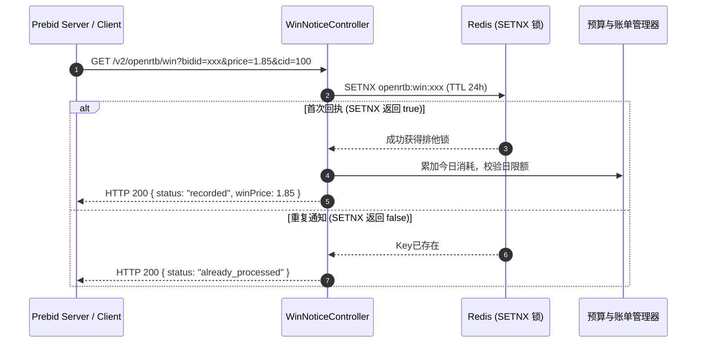

# OpenRTB 2.5 协议与 Prebid Server 对接规范

## 1. 协议概述

本 DSP 系统全面遵循 IAB **OpenRTB 2.5** 规范，原生兼容 **Prebid Server**（Header Bidding）与标准 ADX 流量聚合网关，支持 Banner（横幅/展示位）、原生（Native）以及视频（Video）广告的出价决策与胜出核销。

---

## 2. 实时出价接口 (Bid Request / Response)

### 2.1 接口端点
* **URL**: `POST /v2/openrtb/bid`
* **Content-Type**: `application/json; charset=UTF-8`
* **超时要求**: 建议 Prebid Server 侧配置出价超时时间为 `150ms ~ 300ms`。

### 2.2 请求体格式 (BidRequest)
```json
{
  "id": "auction-req-10001",
  "imp": [
    {
      "id": "imp-1",
      "banner": {
        "w": 300,
        "h": 250,
        "pos": 1,
        "format": [
          {"w": 300, "h": 250}
        ]
      },
      "bidfloor": 1.50,
      "bidfloorcur": "CNY",
      "secure": 0
    }
  ],
  "site": {
    "id": "site-99",
    "domain": "example.com",
    "cat": ["IAB1-1"]
  },
  "device": {
    "ip": "116.228.89.10",
    "ua": "Mozilla/5.0 (iPhone; CPU iPhone OS 16_0 like Mac OS X)...",
    "make": "Apple",
    "model": "iPhone",
    "os": "iOS"
  },
  "user": {
    "id": "usr-889900"
  },
  "tmax": 200
}
```

### 2.3 响应体格式 (BidResponse)

#### 命中候选并参与出价 (HTTP 200 OK)
```json
{
  "id": "auction-req-10001",
  "seatbid": [
    {
      "bid": [
        {
          "id": "bid-9876543210",
          "impid": "imp-1",
          "price": 2.50,
          "nurl": "http://dsp.example.com/v2/openrtb/win?bidid=bid-9876543210&price=${AUCTION_PRICE}&cid=100",
          "adm": "<a href=\"http://click.example.com\"></a>",
          "crid": "mat-500",
          "cid": "100",
          "w": 300,
          "h": 250
        }
      ],
      "seat": "dsp-seat-1"
    }
  ],
  "bidid": "bid-9876543210",
  "cur": "CNY"
}
```

#### 未命中任何活动或放弃出价 (HTTP 204 No Content)
* 返回状态码: `204 No Content`
* 响应体: 空（直接返回 HTTP 204，Prebid Server 即可获悉该 DSP 不出价，减少带宽与解析耗时）。

---

## 3. 胜出通知与计费回执 (Win Notice / Billing)

### 3.1 接口端点
* **URL**: `GET|POST /v2/openrtb/win`
* **触发时机**: 当客户端或 Prebid Server 判定本 DSP 赢得拍卖并展示广告后触发。

### 3.2 动态价格宏替换 (`${AUCTION_PRICE}`)
在 OpenRTB 2.5 与 Prebid Server 规范中，胜出回执 URL（`nurl`）包含价格宏 `${AUCTION_PRICE}`。媒体方将该宏动态替换为最终结算价：
* 示例请求：`GET /v2/openrtb/win?bidid=bid-9876543210&price=1.85&cid=100`
* 系统接收到后，以结算价格 `1.85 CNY` 作为计费依据，而非出价上限 `2.50 CNY`。

### 3.3 幂等防重保障


---

## 4. 实时日预算熔断机制 (Budget Circuit Breaker)

为防止广告主或活动产生不可控的预算超支（超卖），系统建立了毫秒级预算熔断闭环：
1. **胜出实时扣减**：每次胜出回执通过 Redis 原子递增当日累计扣减金额；
2. **熔断阈值检测**：当 `今日已扣金额 >= Campaign.budget` 时，自动在 Redis 标记熔断状态；
3. **出价前置拦截**：`OpenRtbBiddingEngine` 检索候选广告活动时，若发现活动已熔断，则直接剔除，避免继续产生胜出账单。

---

## 5. 多媒体创意渲染规范 (Multi-Format Ad Rendering)

系统全面适配 Banner、Video（视频）与 Native（信息流原生）三大主流广告物料形态，由出价引擎根据 `imp` 请求规格动态选择并调用 `Material.renderAdm(...)` 生成响应代码：

### 5.1 Banner (横幅/插屏/富媒体)
* **表现形态**：标准 HTML、图片超链接、iFrame 或 JS 代码片段。
* **展现上报**：内嵌宏替换 URL 与展示探针。
* **示例代码**：
  ```html
  <a href="http://dsp.example.com/v2/openrtb/click?bidid=bid-123&click_url=http%3A%2F%2Flanding.com" target="_blank">
    
  </a>
  ```

### 5.2 Video (IAB VAST 3.0 视频广告)
* **表现形态**：返回符合 IAB VAST 3.0 标准的 XML 结构（封装于 `BidResponse.seatbid[].bid[].adm`）。
* **关键字段**：包含 `<InLine>`、视频时长 `<Duration>`、媒体文件 `<MediaFiles><MediaFile>`（指定 MIME 类型与比特率）、曝光事件 `<Impression>` 与点击跳转 `<VideoClicks><ClickThrough>`。
* **XML 示例**：
  ```xml
  <?xml version="1.0" encoding="UTF-8"?>
  <VAST version="3.0">
    <Ad id="mat-201">
      <InLine>
        <AdSystem version="1.0">OpenRTB-DSP</AdSystem>
        <AdTitle>Video Ad 201</AdTitle>
        <Impression><![CDATA[http://dsp.example.com/v2/openrtb/win?bidid=bid-123&price=${AUCTION_PRICE}]]></Impression>
        <Creatives>
          <Creative sequence="1">
            <Linear>
              <Duration>00:00:15</Duration>
              <MediaFiles>
                <MediaFile delivery="progressive" type="video/mp4" width="640" height="360" bitrate="800">
                  <![CDATA[http://cdn.example.com/video/sample.mp4]]>
                </MediaFile>
              </MediaFiles>
              <VideoClicks>
                <ClickThrough><![CDATA[http://dsp.example.com/v2/openrtb/click?bidid=bid-123]]></ClickThrough>
              </VideoClicks>
            </Linear>
          </Creative>
        </Creatives>
      </InLine>
    </Ad>
  </VAST>
  ```

### 5.3 Native (IAB OpenRTB Native 1.2 原生信息流)
* **表现形态**：返回符合 IAB Native 1.2 规范的 JSON 字符串（封装于 `adm` 字段）。
* **原生资产 (Assets)**：
  - `title`: 标题文本（不超过 25 或指定字符）
  - `img`: 大图（Main Image）或应用图标（Icon）
  - `data`: 描述说明文本与行动呼吁文案（CTA: 如“立即下载”、“去购买”）
  - `link`: 点击跳转落地页与第三方点击追踪
* **JSON 示例**：
  ```json
  {
    "native": {
      "ver": "1.2",
      "assets": [
        {"id": 1, "required": 1, "title": {"text": "精选好物推荐"}},
        {"id": 2, "required": 1, "img": {"type": 3, "url": "http://cdn.example.com/img.png", "w": 1200, "h": 627}},
        {"id": 3, "required": 0, "img": {"type": 1, "url": "http://cdn.example.com/icon.png", "w": 128, "h": 128}},
        {"id": 4, "required": 0, "data": {"type": 2, "value": "立享限时新人满减优惠，点击了解"}},
        {"id": 5, "required": 0, "data": {"type": 12, "value": "立即抢购"}}
      ],
      "link": {
        "url": "http://dsp.example.com/v2/openrtb/click?bidid=bid-123"
      },
      "imptrackers": [
        "http://dsp.example.com/v2/openrtb/win?bidid=bid-123&price=${AUCTION_PRICE}"
      ]
    }
  }
  ```

---

## 6. 预竞价反作弊过滤体系 (Pre-bid Anti-Fraud Engine)

系统内置 `AntiFraudFilter` 毫秒级预检组件，在执行复杂的活动与物料匹配计算前，过滤无效流量与作弊请求：

1. **云厂商/IDC机房 IP 高速阻断**：
   - 广告点击与展示通常来自真实移动终端或家庭宽带，机房流量多为爬虫与刷量代理。
   - 算法采用 32 位整型掩码位运算，预加载 AWS, Google Cloud, 阿里云, 腾讯云, DigitalOcean, Hetzner 等云服务商核心 CIDR IP 段（29+ 常见网段），单次 IP 校验在纳秒级完成。
2. **恶意爬虫与自动化 Bot UA 正则过滤**：
   - 内置高性能预编译正则，拦截包含 `bot`, `spider`, `crawl`, `curl`, `python`, `scrapy`, `headlesschrome`, `phantomjs`, `postman` 等特征的 User-Agent。
3. **动态 IP 惩罚黑名单**：
   - 支持通过 Redis `antifraud:blacklist:ip:<ip>` 维护动态封禁名单，阻断高频刷量与异常 IP。
4. **快速阻断响应 (HTTP 204 No-Bid)**：
   - 一旦触发上述任一反作弊规则，引擎立即返回 HTTP 204 No Content，阻断后续候选查询与出价计算，保障 DSP 集群计算算力。

---

## 7. 精细化展示频次控制 (Frequency Capping)

为提升受众体验并避免对单一用户过度重复曝光，系统支持活动维度的日/小时频控：

1. **唯一设备/用户提炼规则**：
   - 优先级 1：设备唯一广告标识符 `device.ifa`（如 iOS IDFA / Android GAID）
   - 优先级 2：媒体方用户标识符 `user.id`
   - 优先级 3：兜底基于 `MD5(device.ip + ":" + device.ua)` 提炼伪设备指纹
2. **双时间窗口原子计数 (Redis INCR)**：
   - **天级窗口**：`openrtb:fc:daily:<campaign_id>:<user_id>`（TTL 自动对齐至当天 23:59:59）
   - **小时级窗口**：`openrtb:fc:hour:<campaign_id>:<user_id>`（TTL 自动对齐至当小时 59:59）
3. **竞价前置核验**：
   - 当 `Campaign.freqCapDaily > 0` 且 `dailyCount >= freqCapDaily` 时，自动跳过；
   - 当 `Campaign.freqCapHourly > 0` 且 `hourlyCount >= freqCapHourly` 时，自动跳过；
   - 胜出确认后，原子自增计数，确保频控在分布式环境下的精确一致。

---

## 8. 预算平滑消耗调度 (Budget Pacing)

系统支持两种预算消耗模式，由广告主在 `Campaign.pacingMode` 中配置：

1. **ASAP 模式 (尽快消耗 / 冲刺跑量)**：
   - 不进行出价速率限制，只要活动有预算且匹配请求即全速参与出价，直至触发全日预算熔断。适合大促节点、新素材冷启动快速测试。
2. **EVEN 模式 (匀速平滑消耗 / Pacing)**：
   - 将日预算平摊至 24 个小时周期：`hourlyTarget = dailyBudget / 24.0`；
   - 结合当前小时分钟进度比（`minuteProgress = (minuteOfDay % 60) / 60.0`），计算当前分钟的预期消耗额度；
   - 若当前小时已消耗金额超出该分钟预期限额，启动**动态概率节流算法 (Probabilistic Throttling)**：
     - 放行概率：`p = (hourlyTarget - currentHourSpent) / (hourlyTarget * (1.0 - minuteProgress))`
     - 若当前小时消耗已超过本小时总配额，直接置零拦截；
     - 避免预算在早晨或流量高峰前半小时即被瞬间耗尽，实现全天均匀触达。

---

## 9. 点击追踪与 S2S 效果转化归因 (Click Tracking & S2S Attribution)

系统提供完整的广告点击重定向与服务端（S2S）效果转化闭环：

### 9.1 点击重定向端点
* **URL**: `GET /v2/openrtb/click`
* **参数**:
  - `bidid`: 竞价唯一 ID（必须）
  - `cid`: 广告活动 ID（必须）
  - `crid`: 素材 ID（可选）
  - `uid`: 用户唯一标识（可选）
  - `target_url`: 广告落地页目标 URL（可选，缺省取素材落地页）
* **处理逻辑**:
  1. 签发全局唯一、高熵的 `click_id`（UUID 生成）；
  2. 将点击上下文（`bidId`, `cid`, `crid`, `userId`, `targetUrl`, `timestamp`）存入 Redis 键 `openrtb:click:<click_id>`，保留 7 天；
  3. 执行 URL 宏替换并将 `click_id` 作为参数注入落地页目标 URL；
  4. 返回 **HTTP 302 Found**，重定向浏览器至目标落地页。

### 9.2 S2S 转化回传归因端点
* **URL**: `GET|POST /v2/openrtb/conversion`
* **参数 / JSON 体**:
  - `click_id`: 点击唯一 ID（必须）
  - `conversion_type`: 转化事件类型（如 `install`, `register`, `order`, `purchase`，缺省为 `default`）
  - `amount`: 转化金额（可选，用于计算电商 GMV / ROAS）
  - `order_id`: 广告主侧交易订单号（可选）
* **归因处理链路**:
  1. **排重防刷 (Deduplication)**：基于 Redis `SETNX openrtb:conv:<click_id>:<conversion_type>` 实施分布式幂等去重，已记录的转化事件返回 `already_recorded`；
  2. **溯源归因 (Attribution)**：读取 `openrtb:click:<click_id>` 获取曝光与出价的 Campaign ID、Material ID 和 User ID；
  3. **异步削峰 (Queue Emission)**：将转化实体封装为消息，投递至 RabbitMQ 队列 `conversion.event.queue`，供后续报表中心、归因看板与实时出价算法模型（oCPC/oCPM）消费。

