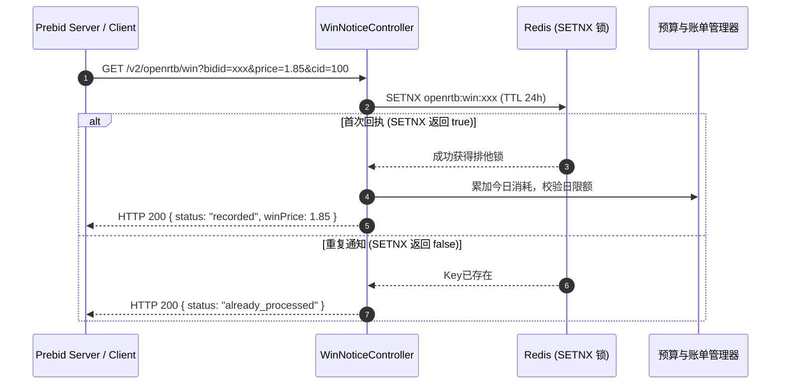

# OpenRTB 2.5 协议与 Prebid Server 对接规范

## 1. 协议概述

本 DSP 系统全面遵循 IAB **OpenRTB 2.5** 规范，原生兼容 **Prebid Server**（Header Bidding）与标准 ADX 流量聚合网关，支持 Banner（横幅/展示位）、原生（Native）以及视频（Video）广告的出价决策与胜出核销。

---

## 2. 实时出价接口 (Bid Request / Response)

### 2.1 接口端点
* **URL**: `POST /v2/openrtb/bid`
* **Content-Type**: `application/json; charset=UTF-8`
* **超时要求**: 建议 Prebid Server 侧配置出价超时时间为 `150ms ~ 300ms`。

### 2.2 请求体格式 (BidRequest)
```json
{
  "id": "auction-req-10001",
  "imp": [
    {
      "id": "imp-1",
      "banner": {
        "w": 300,
        "h": 250,
        "pos": 1,
        "format": [
          {"w": 300, "h": 250}
        ]
      },
      "bidfloor": 1.50,
      "bidfloorcur": "CNY",
      "secure": 0
    }
  ],
  "site": {
    "id": "site-99",
    "domain": "example.com",
    "cat": ["IAB1-1"]
  },
  "device": {
    "ip": "116.228.89.10",
    "ua": "Mozilla/5.0 (iPhone; CPU iPhone OS 16_0 like Mac OS X)...",
    "make": "Apple",
    "model": "iPhone",
    "os": "iOS"
  },
  "user": {
    "id": "usr-889900"
  },
  "tmax": 200
}
```

### 2.3 响应体格式 (BidResponse)

#### 命中候选并参与出价 (HTTP 200 OK)
```json
{
  "id": "auction-req-10001",
  "seatbid": [
    {
      "bid": [
        {
          "id": "bid-9876543210",
          "impid": "imp-1",
          "price": 2.50,
          "nurl": "http://dsp.example.com/v2/openrtb/win?bidid=bid-9876543210&price=${AUCTION_PRICE}&cid=100",
          "adm": "<a href=\"http://click.example.com\"></a>",
          "crid": "mat-500",
          "cid": "100",
          "w": 300,
          "h": 250
        }
      ],
      "seat": "dsp-seat-1"
    }
  ],
  "bidid": "bid-9876543210",
  "cur": "CNY"
}
```

#### 未命中任何活动或放弃出价 (HTTP 204 No Content)
* 返回状态码: `204 No Content`
* 响应体: 空（直接返回 HTTP 204，Prebid Server 即可获悉该 DSP 不出价，减少带宽与解析耗时）。

---

## 3. 胜出通知与计费回执 (Win Notice / Billing)

### 3.1 接口端点
* **URL**: `GET|POST /v2/openrtb/win`
* **触发时机**: 当客户端或 Prebid Server 判定本 DSP 赢得拍卖并展示广告后触发。

### 3.2 动态价格宏替换 (`${AUCTION_PRICE}`)
在 OpenRTB 2.5 与 Prebid Server 规范中，胜出回执 URL（`nurl`）包含价格宏 `${AUCTION_PRICE}`。媒体方将该宏动态替换为最终结算价：
* 示例请求：`GET /v2/openrtb/win?bidid=bid-9876543210&price=1.85&cid=100`
* 系统接收到后，以结算价格 `1.85 CNY` 作为计费依据，而非出价上限 `2.50 CNY`。

### 3.3 幂等防重保障


---

## 4. 实时日预算熔断机制 (Budget Circuit Breaker)

为防止广告主或活动产生不可控的预算超支（超卖），系统建立了毫秒级预算熔断闭环：
1. **胜出实时扣减**：每次胜出回执通过 Redis 原子递增当日累计扣减金额；
2. **熔断阈值检测**：当 `今日已扣金额 >= Campaign.budget` 时，自动在 Redis 标记熔断状态；
3. **出价前置拦截**：`OpenRtbBiddingEngine` 检索候选广告活动时，若发现活动已熔断，则直接剔除，避免继续产生胜出账单。
